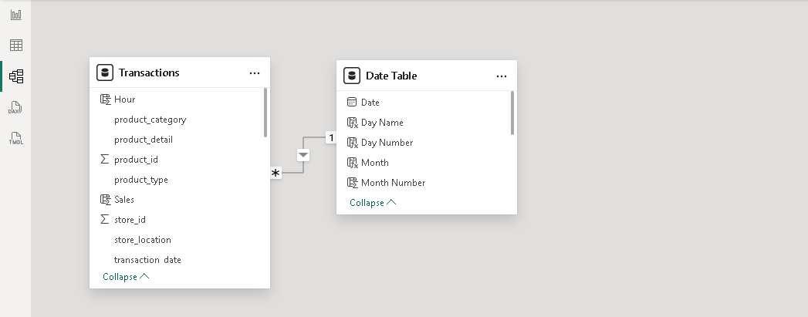
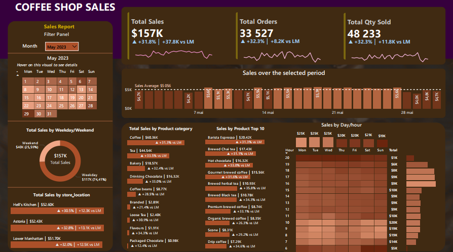
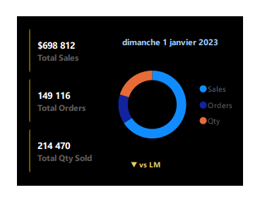
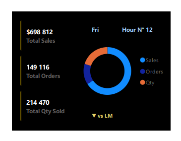

# Coffee Shop Sales Analytics
## Revenue Performance, Customer Demand Analysis & Operational Optimization

### An End-to-End Retail Business Intelligence Project

**Author:** Brice Abogo  
**Specialization:** Financial Analysis | Accounting | Business Intelligence  
**Technologies:** SQL | Power Query | DAX | Power BI | Power BI Service

---

## 1. Project Overview

This project presents an end-to-end Business Intelligence solution designed to analyze the commercial performance of a multi-location coffee shop chain operating across three New York City locations: **Astoria, Hell's Kitchen, and Lower Manhattan**.

The solution transforms **149,116 transaction records** covering the period **January – June 2023** into an interactive decision-support reporting environment.

By combining SQL-based data validation, Power Query transformations, relational data modeling, and advanced DAX time intelligence, the project converts raw point-of-sale transactions into actionable business insights.

The solution enables management to:

- Monitor revenue, order volume, and quantity sold through dynamic KPIs.
- Track Month-over-Month (MoM) growth with automatic variance indicators.
- Identify peak selling hours and high-performing days of the week.
- Compare sales performance across store locations.
- Analyze product category and product-level revenue contribution.
- Distinguish weekday versus weekend demand patterns.
- Benchmark daily sales against the period average.
- Support staffing, inventory, and product-mix decisions.

The report was published to **Power BI Service** and configured with an **On-premises Data Gateway (Standard mode)** for secure, scheduled data refresh from locally hosted sources.

---

## 2. Business Problem

Coffee retail is a high-volume, low-ticket business where profitability depends on the ability to manage strong demand variability across hours, days, and locations.

Operators frequently face challenges such as:

- Limited visibility over daily and hourly revenue dynamics.
- Difficulty identifying peak activity windows for staffing optimization.
- Complex product portfolios mixing high-volume and marginal items.
- Insufficient comparison of store-level performance.
- Limited analytical support for product-mix and promotional decisions.

Without structured analytics, these challenges translate into suboptimal staffing, stock imbalances during rush hours, and missed revenue opportunities.

### Central Business Question

**How can transactional sales data analytics improve revenue monitoring, demand pattern recognition, and operational decision-making in a multi-store coffee retail environment?**

---

## 3. Project Objectives

The main objective is to develop an interactive retail analytics solution providing management with reliable, timely information on sales performance and customer demand.

Specific objectives include:

1. Consolidating point-of-sale transaction data into a structured analytical model.
2. Building core commercial KPIs: Total Sales, Total Orders, and Total Quantity Sold.
3. Measuring Month-over-Month growth with dynamic variance indicators.
4. Benchmarking daily sales against the period average.
5. Identifying peak revenue hours and best-performing weekdays.
6. Evaluating and comparing store location performance.
7. Ranking product categories and identifying the top 10 revenue-generating products.
8. Segmenting demand between weekdays and weekends.
9. Delivering an interactive dashboard with custom tooltips and cloud-based scheduled refresh.

---

## 4. Tools & Technologies

| Technology | Application |
|---|---|
| SQL (MySQL) | Data cleaning, data type standardization, and business analysis queries |
| Power Query (M) | Data extraction, cleaning, and transformation (ETL) |
| Power BI Desktop | Relational data modeling and interactive dashboard development |
| DAX | KPIs, time intelligence, dynamic labels, and conditional formatting |
| Power BI Service | Report publication and semantic model management |
| On-premises Data Gateway (Standard) | Secure connectivity to locally hosted data sources |
| GitHub | Technical documentation and project portfolio |

---

## 5. Dataset Description

The project is built on a publicly available retail transactions dataset sourced from the internet.

**Source formats:**
- **CSV** — used for SQL-based data validation and analysis.
- **XLSX** — used as the Power BI data source.

### Transactions — Fact Table

Contains **149,116 transaction records** (January – June 2023), including:

- `transaction_id` — unique transaction identifier.
- `transaction_date` / `transaction_time` — timestamp of the sale.
- `transaction_qty` — quantity sold.
- `unit_price` — unit selling price.
- `store_id` / `store_location` — store identification (Astoria, Hell's Kitchen, Lower Manhattan).
- `product_id` / `product_category` / `product_type` / `product_detail` — product hierarchy.

### Date Table — Calendar Dimension

A calculated table built in DAX (`CALENDAR`) covering the full transaction period, providing:

- Date, Day Name, Day Number, Week Number.
- Month, Month Number, Month Year.
- Weekday Number and Weekday/Weekend classification.

---

## 6. Data Preparation & Transformation

### SQL Data Cleaning & Validation

The SQL layer was used to standardize and validate the raw data before analysis:

- Conversion of `transaction_date` from text to a proper `DATE` data type.
- Conversion of `transaction_time` from text to a proper `TIME` data type.
- Correction of a BOM encoding artifact in the `transaction_id` column header.
- Execution of business analysis queries (KPIs, MoM growth, peak hours, top products).

### Power Query (ETL)

The Power BI data pipeline includes:

- Data type verification and conversion for all columns.
- Header promotion and schema standardization.
- Validation of the transaction grain across the full dataset.

### Cross-Tool Reconciliation

A control check was performed between the SQL output and the Power BI report:

**SQL Total Sales (Jan–Jun 2023) = Power BI Total Sales = $698,812**

This reconciliation confirms the consistency of the ETL pipeline and the reliability of the reported figures.

Detailed scripts are available in the `sql/` and `powerquery/` directories.

---

## 7. Data Modeling

The Power BI solution uses a **star schema** composed of:

- **Transactions** (Fact table) — sales transactions at line level.
- **Date Table** (Dimension) — calendar dimension for time intelligence.

### Relationship

| Property | Configuration |
|---|---|
| Cardinality | Many-to-One (`*:1`) |
| Relationship | `Transactions[transaction_date]` → `Date Table[Date]` |
| Cross-filter direction | Single |
| Status | Active |

This structure guarantees filter propagation from the calendar dimension to the fact table, ensuring consistent time intelligence across all visuals.

### Data Model



---

## 8. Key Performance Indicators

### Full Period Results (January – June 2023)

| KPI | Result |
|---|---:|
| Total Sales | $698,812 |
| Total Orders | 149,116 |
| Total Quantity Sold | 214,470 |

### Current Month Focus — May 2023

| KPI | May 2023 | vs April 2023 (LM) |
|---|---:|---:|
| Total Sales | $157K | ▲ +31.8% (+$37.8K) |
| Total Orders | 33,527 | ▲ +32.3% (+8.2K) |
| Total Quantity Sold | 48,233 | ▲ +32.4% (+11.8K) |
| Average Daily Sales | $5,056 | — |

**Note:** Financial amounts are expressed in USD.

---

## 9. Time Intelligence Framework

The report implements a structured DAX time intelligence framework:

- **Current Month (CM) measures** — `TOTALMTD` calculations dynamically aligned with the selected month.
- **Previous Month (PM) measures** — built with `DATEADD(..., -1, MONTH)` for MoM comparisons.
- **Dynamic KPI labels** — automatic ▲/▼ trend indicators with formatted growth percentage and absolute variance (`vs LM`).
- **Daily average benchmark** — `AVERAGEX` combined with `ALLSELECTED` to compare each day's sales against the visible period average.
- **Conditional classification** — daily bars flagged as *Above Average* or *Below Average*.

The complete DAX implementation is documented in the `dax/` directory.

---

## 10. Dashboard Overview

The Power BI report consists of one main analytical page supported by two custom tooltip pages.

### Page 1 — Executive Sales Dashboard

Provides a consolidated view of:

- KPI cards: Total Sales, Total Orders, Total Qty Sold (with MoM trend indicators and sparklines).
- Interactive calendar with month filtering.
- Daily sales versus period average, with above/below average classification.
- Weekday versus weekend revenue split.
- Sales by store location with MoM variance.
- Sales by product category and Top 10 products.
- Sales by day/hour heatmap for demand pattern analysis.



### Tooltip Page — Calendar

Custom tooltip displaying daily performance details (sales, orders, quantity) when hovering over calendar dates.



### Tooltip Page — Day/Hour

Custom tooltip displaying granular performance indicators for any day-of-week and hour combination in the heatmap.



---

## 11. Key Findings

### Finding 1 — Exceptional May Performance

May 2023 revenue reached **$157K**, up **+31.8%** versus April (+$37.8K), making it the strongest month of the period. Growth was broad-based: orders (+32.3%) and quantity sold (+32.4%) grew at the same pace, indicating genuine volume-driven expansion rather than price effects.

### Finding 2 — Growth Is Consistent Across Stores and Categories

All three store locations grew between **+30.5% and +32.8%** MoM, and every product category grew between **+12.4% and +34.3%**, confirming a systemic demand increase rather than a localized effect.

### Finding 3 — Weekday-Driven Demand

Weekdays generate **74.41% of May revenue ($117K)** versus 25.59% on weekends. Monday to Wednesday are the strongest days (approximately **$25K each**), consistent with a commuter- and office-worker-driven customer base.

### Finding 4 — Concentrated Morning Peak

The **7 AM – 10 AM window generates approximately 46% of May revenue**, with 10 AM as the single largest hour (~$20K). This concentration is a critical driver for staffing, preparation, and inventory decisions.

### Finding 5 — Balanced Store Portfolio

The three locations contribute nearly equal revenue shares: Hell's Kitchen ($52.60K), Astoria ($52.43K), and Lower Manhattan ($51.70K) — approximately **33% each**. No location underperforms, but the uniformity may also indicate capacity constraints during peak hours.

### Finding 6 — Product Concentration

Coffee ($60.36K) and Tea ($44.54K) represent approximately **67% of May revenue**. The top product, **Barista Espresso ($20.42K)**, alone accounts for ~13% of monthly sales. Conversely, Packaged Chocolate ($0.98K) and Flavours ($1.91K) are marginal contributors.

---

## 12. Business Recommendations

### Recommendation 1 — Align Staffing with the Morning Peak

Concentrate staff scheduling and product preparation between 6 AM and 11 AM, when nearly half of daily revenue is generated, to reduce service time and protect the customer experience during rush hours.

### Recommendation 2 — Develop Weekend Revenue

Introduce weekend-specific offers (brunch bundles, family combos, loyalty incentives) to raise weekend contribution above its current 25.59% share.

### Recommendation 3 — Secure Top-Seller Availability

Ensure priority stock and equipment availability for espresso- and chai-based products during peak hours, given their outsized revenue contribution.

### Recommendation 4 — Optimize the Product Portfolio

Review marginal categories (Packaged Chocolate, Flavours) for delisting, bundling, or repositioning to free shelf space and simplify operations.

### Recommendation 5 — Strengthen Bakery Attachment

Bakery represents $18.57K versus $60.36K for Coffee. Targeted coffee-and-pastry bundles during the morning peak could increase the average basket size.

### Recommendation 6 — Monitor Growth Sustainability

Track whether May's growth drivers persist in subsequent months, and document promotional or seasonal factors to make the performance repeatable.

---

## 13. Technical Architecture

The solution follows an end-to-end retail analytics workflow:

```text
   Excel / CSV Data Source
            |
            v
   SQL Data Cleaning & Validation
            |
            v
      Power Query (ETL)
            |
            v
   Star Schema Data Modeling
   (Transactions + Date Table)
            |
            v
   DAX KPIs & Time Intelligence
            |
            v
   Power BI Interactive Dashboard
   (Main Page + Tooltip Pages)
            |
            v
       Power BI Service
            |
            v
   On-Premises Data Gateway (Standard)
            |
            v
     Scheduled Data Refresh
```

The project demonstrates practical experience in data preparation, relational modeling, dashboard development, and cloud reporting infrastructure.

---

## 14. Skills Demonstrated

### Financial & Business Analysis

- Revenue Performance Monitoring.
- KPI Design and Variance Analysis.
- Month-over-Month Growth Analysis.
- Demand Pattern Recognition.
- Product Portfolio Analysis.
- Store Performance Benchmarking.
- Data-Driven Business Recommendations.

### Data Analytics & Business Intelligence

- SQL (data cleaning, validation, business queries).
- Power Query (M).
- Power BI Desktop.
- DAX (time intelligence, dynamic labels, conditional formatting).
- Relational Data Modeling (star schema).
- Custom Tooltip Design.
- Interactive Dashboard Design.

### Data Infrastructure

- Power BI Service.
- On-premises Data Gateway (Standard mode).
- Semantic Model Configuration.
- Scheduled Refresh Configuration.

---

## 15. Project Repository Structure

The repository is organized as follows:

```text
coffee-shop-sales-analytics/
│
├── README.md
├── sql/
│   └── coffee_shop_analysis.sql
├── powerquery/
│   └── data_transformation.pq
├── dax/
│   └── business_measures.dax
├── images/
├── reports/
└── documentation/
```

Each directory contains the relevant scripts, visualizations, reports, or technical documentation.

---

## 16. Power BI Dashboard & Report

The Coffee Shop Sales dashboard was developed using Power BI Desktop and published to **Power BI Service**, with scheduled refresh configured through an **On-premises Data Gateway (Standard mode)**.

The complete report is available in PDF format, allowing recruiters and visitors to review the analysis without requiring a Power BI account. The original `.pbix` file is also provided for technical review.

### Explore the Project

[**View the Complete Power BI Dashboard (PDF)**](reports/coffee-shop-sales-dashboard.pdf)

[**Download the Power BI Report (.pbix)**](reports/coffee-shop-sales.pbix)

[**Explore Dashboard Screenshots**](images/)

[**View the Power BI Data Model**](images/data-model.png)

Public interactive access is currently unavailable due to Power BI sharing restrictions.

---

## 17. About the Author

### Brice Abogo

**Financial Analyst | Accountant | Data Analyst**

Finance and accounting professional with more than fifteen years of experience in accounting, auditing, financial management, and financial reporting (IFRS and OHADA frameworks), currently completing the ACCA Strategic Professional level.

Combining deep financial expertise with modern analytical tools — including SQL, Power BI, DAX, Excel, and Python — to transform raw data into actionable business insights.

**LinkedIn:** https://www.linkedin.com/in/brice-abogo

**Email:** briceabogo@gmail.com
**Email:** briceabogo@lynis.online

---

## 18. Project Status

**Status:** Completed — Release `v1.0.0`

The project delivers a complete end-to-end retail sales analytics workflow:

- SQL-based data cleaning, standardization, and business analysis.
- Power Query ETL pipeline with cross-tool reconciliation ($698,812 validated).
- Star schema data modeling with an active Many-to-One calendar relationship.
- DAX time intelligence framework (CM/PM measures, MoM growth, dynamic trend labels).
- Interactive Power BI dashboard with two custom tooltip pages.
- Cloud publication to Power BI Service with scheduled refresh via an On-Premises Data Gateway (Standard mode).
- Executive business findings and actionable operational recommendations.
